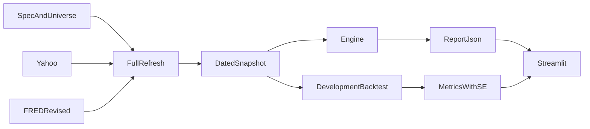

# Local US market analyzer

## What this version claims

The only tested claim is a sector-ETF momentum rule. It is written down before any result is looked at, and v1 does not search over alternatives.

On the primary sample that claim is not expected to clear the pass rule. About 62 development signals and 23 completed holdout signals, with a monthly excess standard deviation of 1.5 to 2 points, put the standard error near 0.2 in development and near 0.3 to 0.4 in holdout. Support requires two governing standard errors. That is roughly 0.4 points a month in development and 0.6 to 0.8 in holdout, which is larger than a realistic sector-rotation edge. Inconclusive is the expected label. An inconclusive result freezes the spec, does not open the holdout a second time, and does not send us looking for another window. The market tag says inconclusive and still shows the mean, the governing standard error, and n. The append-only ledger is what we add instead of another backtest.

There is no name-level backtest. A momentum sort of today's large caps looks good by construction. The name table is a description of the latest snapshot. It has no excess-return statistic.

There is no cross-sector fundamental rank and no combined score. Forward P/E is not comparable across sectors and is the wrong metric for REITs. ROE is distorted by buybacks and negative equity. A median of eight names does not represent cap-concentrated ETFs. Those fields stay per-name facts, with explicit blanks where the value is unfit.

The regime label is displayed and changes nothing downstream. The backtest result schema has no regime field.

## Precommitted spec

Stored in [`config/spec.yaml`](config/spec.yaml). The loader rejects unknown keys. [`config/weights.yaml`](config/weights.yaml) is not used, so fundamental weights cannot hide there. Nothing in this file is fit on the holdout.

- Windows, in calendar months, month-end to month-end: 3, 6, and 12-1 (the span from 12 months before the signal month-end to 1 month before it).
- Each window is converted to a cross-sectional rank of total return, rank 1 best, ties receiving the average rank. Windows are combined as the weighted average of those ranks. Default weights are equal. They are weights on ranks, not on raw returns and not on z-scores. With 11 ETFs, a raw-return average would let the 12-month window dominate, and a z-score would let one outlier dominate.
- On the primary sample, a month where any of the 11 ETFs is missing a window is a hard error. The command writes no result. The wealth series and the autocorrelation are never computed across a hole. A missing window in this sample is a fetch failure, not a thin month. Weights are not renormalized.
- Hold the three best average ranks at equal weight, one third each. Tie-break for the marginal slot: better 12-1 rank, then better 6-month rank, then better 3-month rank, then ticker alphabetical. Record when a tie-break fires.
- Signal from the total-return index at the month-end session. Fill at the next session's index close. The holding return runs from that close to the next execution close. The signal bar is not a trade bar. A signal counts in a performance sample only when that exit close exists.
- One-way turnover is half the sum of absolute weight changes, after drift, at the execution close. `cost_bps` is 10 and means the cost of one side. Cost drag for the month is `2 * one_way_turnover * 10 bps`, charged to the strategy and, separately, to the benchmark.
- v1 does not run a weight search. There is no 0.2-point indifference band. That band sits inside one standard error of both primary slices, so it cannot separate a real edge from noise.

Subtracting SPY from every sector does not change the order, so it is not in the score. The sector table may show a "vs SPY" column labeled as display-only. The sort key is the average rank of total returns.

## Samples

XLC listed on 18 June 2018. XLRE listed in October 2015. The other nine Select Sector SPDRs listed in December 1998. The GICS rebalance after the close on 21 September 2018 removed names from XLK and XLY and completed XLC. Alphabet and Meta left Technology. Media names, including Disney, Netflix, and Comcast, left Consumer Discretionary. From the XLC listing until that rebalance, some holdings sat in XLC and in XLK or XLY at the same time. The sector labels are not one economic series across that date. The ETF returns are still real and tradable. A momentum rule on tradable ETFs does not need the label to mean the same thing before and after.

Vendor backfill before a list date is discarded. An ETF's first month counts only when it was listed before that month's first session. List-date floors live in [`config/universe.yaml`](config/universe.yaml).

**Primary sample.** All 11 ETFs, fixed membership, full calendar months after the rebalance. October 2018 is the first usable return month. The first signal is the first month-end at which every window is available for all 11, which is September 2019 when 12-1 is the longest window. The CLI prints the date and the count.

**Robustness sample, precommitted now.** From the first month-end at which the original ETFs have every window, about the start of 1999. At each date the universe is whichever ETFs have all three windows. The full tradable history through September 2026 is about 320 months. The development command reports only the part before November 2024, about 300 months, so the robustness average is not a way to see the holdout. XLRE and XLC join only once they qualify, which keeps XLC out of the months when its holdings were still inside XLK or XLY. The result is labeled `robustness`. It uses the same spec, the same pass rule, and the equal-weight portfolio of that month's eligible ETFs. Even at about 300 months, a 1.5 to 2 point monthly standard deviation leaves a governing standard error near 0.1, so two standard errors is still about 0.2 points a month. The long sample can contradict a sign and can support a large persistent edge. It cannot promote an inconclusive primary. An eligible ETF with a missing bar is a hard error. An ETF that has not finished its windows is absent from that month, which is membership, not a dropped month.

## Holdout, pass rule, and the live ledger

Performance samples contain only signals whose exit close exists. The October 2026 signal fills at the first November close and exits at the first December close. As of 12 November 2026 that exit does not exist, so October 2026 is not in the holdout.

- Development: every valid primary signal before 2024-11-01. That is September 2019 through October 2024, about 62 signals, and those holding periods are complete.
- Holdout: primary signals from November 2024 through September 2026, inclusive. That is 23 signals. The interval does not grow to include October 2026 once December's close exists.
- October 2026 and every later signal are the live tail.

`backtest` reads only the development range and writes the primary and robustness results beside it. `backtest --holdout` is a separate command. It writes the primary holdout and the robustness months from November 2024 through September 2026 into one sealed file. It refuses to run if a holdout file for this `spec_hash` already exists. The file records the `snapshot_id` it was computed from and is not regenerated when a later snapshot differs.

The governing standard error is the AR(1)-adjusted error `s / sqrt(n) * sqrt((1+ρ)/(1-ρ))` when `0 < ρ < 1`, and the classical error `s / sqrt(n)` otherwise. The result stores that choice as `governing_se`. The claim is one-sided: positive excess against the sample's equal-weight benchmark.

- **Support:** mean excess is at least two governing standard errors.
- **Contradicted:** mean excess is zero or negative.
- **Inconclusive:** mean excess is positive and below two governing standard errors.

The same words apply to primary development, primary holdout, and robustness. Only the primary development label is the claim. Holdout support is not a realistic outcome at this n, and an inconclusive holdout is not confirmation. It is also not a reason to look again.

Reported with the label: n, mean excess, sample standard deviation, classical SE, lag-1 autocorrelation, governing SE, hit rate, worst strategy month, worst excess month, average one-way turnover, total cost drag, max drawdown of strategy wealth, and max drawdown of `cumprod(1+r_strategy) / cumprod(1+r_benchmark)`.

**Ledger.** `data/ledger/signals.jsonl` is append-only. After 16:15 America/New_York on a signal month-end, the tool appends the signal: month-end date, ranks, selected tickers, weights, `spec_hash`, `snapshot_id`, and `written_at`. A row written before that signal's execution close is `logged_live`. A row written later is `reconstructed` and is excluded from the forward count. When the exit close exists, the tool appends a settlement line that references the signal id. It does not edit the signal line. The forward record is the sample that was not available when this rule was chosen. Reconstructed rows are shown separately so a late start is not mistaken for that record.

## Benchmark

On the primary sample the skill benchmark is the equal-weight portfolio of all 11 sector ETFs, rebalanced on the same next-close clock, with the same cost rule. On the robustness sample it is the equal-weight portfolio of the ETFs eligible that month. Three equal-weighted sectors against cap-weighted SPY would mix sector selection with an equal-weight tilt.

SPY is reported on that same clock as market context. It is not the denominator of excess return.

## Prices and snapshots

Fetch with `auto_adjust=False`. Store the split-adjusted `Close` and the dividend cash amounts. Build the total-return index inside the snapshot:

`tr[t] = tr[t-1] * (close[t] + dividend[t]) / close[t-1]`

Do not store or hash Yahoo's adjusted close. Sector ETFs pay dividends quarterly, and Yahoo rebases the entire adjusted history each time, so an adjusted-close hash changes even when the raw history did not. A new dividend appends an event. Prior closes and prior dividends stay, and the total-return index through the previous ex-date stays. A revision of a past dividend changes the hash, which is the revision we need to see.

Every refresh replaces the working copy with a full refetch. Nothing is incrementally appended. A daily bar is kept only when the fetch time is at or after 16:15 America/New_York on that session date. An earlier refresh drops today's bar, and a month-end signal is not formed from it.

Each refresh is archived under `data/snapshots/<as_of>/`. A backtest reads one snapshot and never splices two. The result filename includes `spec_hash` and a hash of closes plus dividend events. The holdout file is pinned to the snapshot it was run on.

`yfinance` is pinned in `pyproject.toml` to the version installed at implementation. Fundamental requests are serial, with a pause between tickers, one retry, and the failure stored on that ticker. The dashboard never calls Yahoo.

## Live description

These blocks do not enter the backtest.

**Regime**, display only, label set `risk-on`, `neutral`, `risk-off`, or `unavailable`. Inputs, all required:

- Trend is up when the SPY total-return index is above its 200-trading-day average, using completed bars only.
- Breadth is high when at least 8 of the 11 sector ETFs are above their own 200-trading-day total-return average, and low when 4 or fewer are. If any of the 11 lacks a 200-day average, the label is `unavailable`.
- VIX is low below 20, elevated from 20 up to but not including 30, and high at 30 or above. The series is `^VIX`, and today's bar follows the same 16:15 rule.
- Unemployment uses the latest FRED `UNRATE` month that has a numeric value, minus the same calendar month one year earlier. Rising means the difference is at least 0.3 percentage points. If either endpoint is missing, the change is null. The code does not step to a neighboring month.

Combination:

- `risk-off` when trend is down and breadth is low, or trend is down and VIX is high.
- `risk-on` when trend is up, breadth is high, VIX is low, and unemployment is known and not rising.
- `neutral` otherwise.
- `unavailable` when trend, breadth, or VIX is missing. A stale unemployment reading blocks `risk-on` and does not by itself set `risk-off`.

The yield curve (`T10Y2Y`) and CPI year-over-year (`CPIAUCSL`) are printed beside the label and are not inputs to it. CPI year-over-year uses the same calendar-month pair. If either endpoint is missing, the display is `unavailable`. FRED values are the current revised vintage. The report marks them `revised`. Replaying the full label on history would require ALFRED vintages and publication lags, which v1 does not do. The report does include a price-only history (trend, breadth, VIX) rebuilt from the current snapshot, for the chart strip below. Unemployment is omitted from that history.

FRED `UNRATE` for 2025-10-01 is a missing value. BLS did not collect the October 2025 household survey and will not collect it retroactively. The latest numeric observation as of 12 November 2026 is 2026-09-01, and its pair, 2025-09-01, is present, so the comparison on this date is intact. The hole binds when either endpoint is October 2025, including the month October 2026 becomes the latest print. BLS also canceled the October 2025 CPI release and carried survey prices forward. Treat 2025-10 as a missing CPI endpoint even if `CPIAUCSL` contains a level.

**Sector table.** The ordering is the last completed month-end signal on this snapshot, labeled with that date. Windows use the total-return index through that month-end and do not include later sessions. A refresh on 12 November 2026 shows the October 2026 month-end session, which is the same construction the backtest uses. It is not a window that ends on 12 November. For each ETF: the three window total returns, each window's rank, the average rank, the horizon gap (`3-month rank` minus `12-1 rank`), the average-rank change versus the prior month-end signal, and the display-only gap versus SPY. There is no fundamental rank and no combined rank.

**Names.** A frozen watchlist of about eight current large caps per sector in [`config/universe.yaml`](config/universe.yaml), used only on the sector screen. Sorted by market cap. Columns are market cap, trailing earnings yield, forward earnings yield, revenue growth, and operating margin. No percentile, no z-score, and no composite. Within eight names a percentile is a step of about an eighth, so the raw value and the coverage count are the display.

Missing and negative values:

- Missing stays blank. It is not filled with zero or with a peer median.
- Trailing or forward earnings yield is shown only when the corresponding earnings are positive. Otherwise the cell reads `negative or missing` and is left out of any count of valid yields.
- Every name in XLRE, and XLRE itself, leaves earnings-yield cells as `not applicable`. The free feed has no FFO.
- Operating margin replaces ROE. Negative book equity cannot flow into a return on equity figure because ROE is not requested. Operating margin is `not applicable` for every name on the XLF watchlist. It is not a meaningful figure for banks and insurers.
- A column header shows `k/n` valid. v1 does not collapse a column into a sector aggregate, so there is no minimum-coverage exception to hide. The `k/n` count is the coverage statement.
- A failed fetch leaves the row in the table with the error string on that row (rate limit, missing field, timeout). Coverage counts include it as not valid.

## Report schema

[`src/market_analysis/reports/schema.py`](src/market_analysis/reports/schema.py) is version 1. Required metadata: `schema_version`, `as_of` (retrieval time), `snapshot_id`, and `spec_hash` on backtest output. Each displayed field carries `value`, `source`, `observed_at`, `retrieved_at`, and `stale`.

Stale rules: a price is stale when its last completed bar is more than five calendar days before `as_of`. A macro series is stale when its observation period ended more than 70 days before `as_of`. Fundamental fields have a null `observed_at` and source text `yahoo current snapshot`, because `.info` does not give a filing date. When `observed_at` is null, `stale` is null. It is not false.

`regime.effect` is the constant `display_only`.

## Flow

The holdout command reads the same snapshot and writes a different file. The app can see that the file exists and does not render its statistics.

## Screens

The app is one Streamlit script, [`web/app.py`](web/app.py). A sector row sets the query param `sector`. The workbench sets `view=workbench`. Each screen is defined by the question it answers. Streamlit reruns the script on param changes; that is acceptable for one local user. No FastAPI and no React in v1.

Shared header on every screen: snapshot `as_of`, `snapshot_id`, price coverage (`11/11` sector ETFs, plus SPY and VIX), name-coverage (`k/n` fundamental fetches), the live-ledger counts (`logged_live` and `reconstructed`), and a refresh control. Refresh calls the same function as the CLI, shows progress, and lists per-ticker failures in an expander. A missing sector ETF is a hard error for the score, not a blank column. A missing name blanks that row and does not block the score.

**Market**, no `sector` param. Question: what is the environment, and which sectors lead on the sealed spec?

- Regime strip, not a banner. Each input prints value, threshold, and pass/fail: `VIX 18.2, low is under 20`. Under the label, one line names the clause that fired.
- SPY total-return chart with a strip underneath for the price-only regime (trend, breadth, VIX), through the last completed session. Caption reports flip count and median spell length on this snapshot. The caption states that unemployment is not in the strip and that the strip is how often the price rule flips, not evidence the label has skill.
- Yield curve and CPI beside the strip, labeled revised, not inputs.
- Sector table sorted by average rank of the labeled month-end signal. The column header carries the primary development label in words (`support`, `contradicted`, or `inconclusive`), then mean excess versus the equal-weight 11, the governing SE, and n. It does not carry a per-row hit rate.
- Horizon gap is a column. An 11-point scatter of 3-month rank against 12-1 rank, with ticker labels, sits above the table so disagreement between the short window and the long window is visible without subtracting columns. Those two windows are inside the tested score. A gap against a fundamental rank is not shown: that gap would be a new untested score sitting in the action column, and a tag on it would be as easy to skip as a disclaimer banner.
- Default sort is average rank. Other columns can be inspected. There is no combined-order column to sort by.
- A row click opens that sector's URL.

**Sector**, `?sector=XLK`. Question: how has this sector's total-return path compared with SPY over the windows the score uses, and what do today's large caps look like in this snapshot?

- The sector's rank row, repeated, with the same development-sample tag.
- One chart of the total-return-index ratio to SPY, through the last completed session. Toggles are 3, 6, and 12-1, measured back from the labeled signal month-end. The 12-1 toggle highlights the span from twelve month-ends before that signal to one month-end before it. Two overlaid price lines are not used.
- Name table as specified above. Fundamental column headers carry the tag `snapshot, not a test`. Names are not sorted by a momentum rank.

**Workbench**, `?view=workbench`. Question: can two development runs be told apart, and is the holdout still sealed?

- This screen does not launch a weight search. It only opens result files the CLI has already written.
- Run list shows the actual window weights, `top_n`, cost, execution rule, holdout dates, `spec_hash`, and `snapshot_id`. The sealed spec is pinned at the top of the list.
- Two development runs can be placed side by side. The diff shows the label, mean excess, governing SE, the difference, and the standard error of the difference. The runs are marked distinguishable only when the absolute difference is at least two standard errors of the difference. The support line on a single run is two governing standard errors, not a fixed 0.2 points.
- The chart plots development-window wealth for the strategy and for the equal-weight 11. SPY wealth is a third line, labeled cap-weighted market, not the skill benchmark. The holdout dates are a shaded span with no performance line. If a holdout file exists, the list shows one locked row with the date range and no statistics.

## Build order

Engine and CLI first. The dashboard is a viewer, and it is last.

1. Project skeleton, pinned `yfinance`, [`config/spec.yaml`](config/spec.yaml), [`config/universe.yaml`](config/universe.yaml).
2. Full refetch of closes and dividends, total-return index, partial-bar rule, dated archive, snapshot hash, throttled fundamentals, FRED with the missing-month rule.
3. Month-end score, regime, name masks, schema with null staleness.
4. Development and one-shot holdout commands, pass labels, equal-weight benchmark, hard errors, append-only ledger.
5. Fixture tests. No network in tests.
6. Streamlit screens above: header and refresh errors, market drill-down, sector ratio chart, workbench with the holdout span empty. No FastAPI and no React in v1.
7. README with the spec, the sample rule, and the limits below.

## Later

Scheduled email stays out of this build. The versioned snapshot is what a later mailer would render. Cursor's Gmail connection is interactive and is not the scheduler.

A point-in-time fundamental panel begins with the archives created here. It is not long enough to test anything in v1.

## Limits the README states

This is a research view, not a recommendation. The primary test is expected to come back inconclusive, and that label is not a prompt to change the spec or to read the holdout again. The robustness sample cannot promote it. The watchlist is today's large caps and is not a backtest universe. `yfinance` is unofficial. Total returns are computed from closes and dividends inside one snapshot. The holdout stays tied to the snapshot it was run on.
